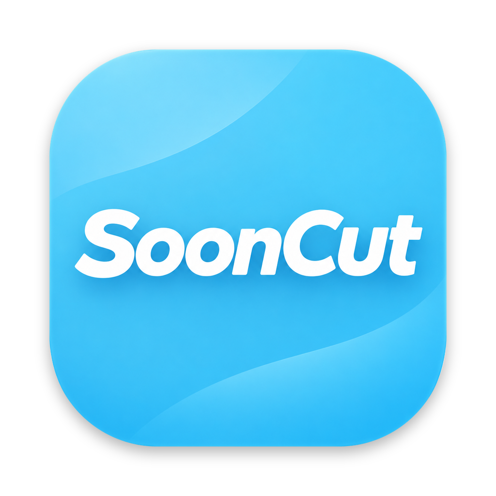
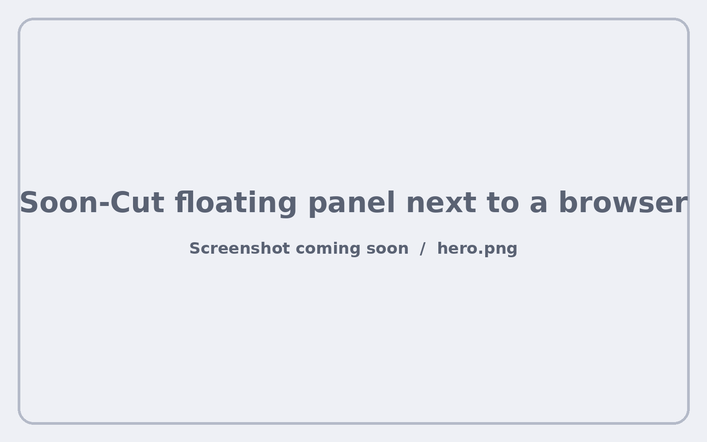
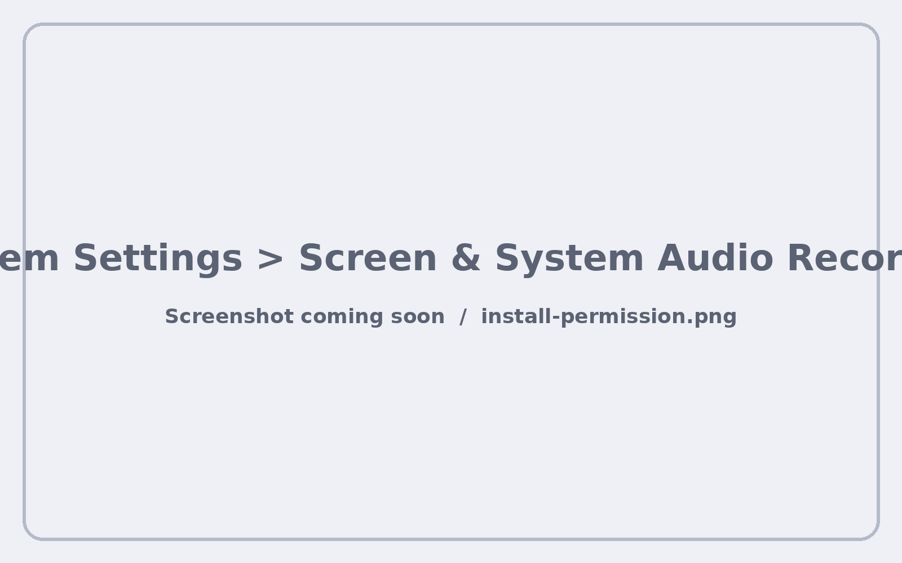
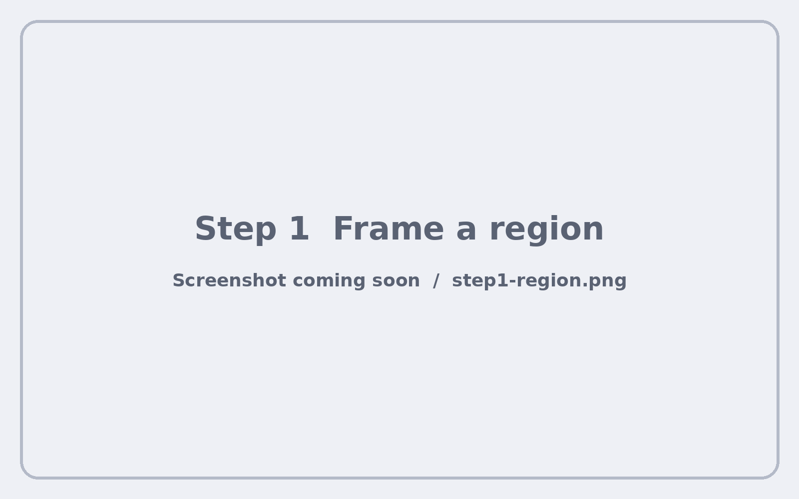
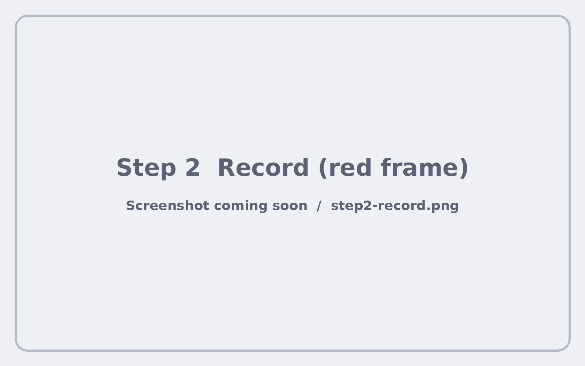
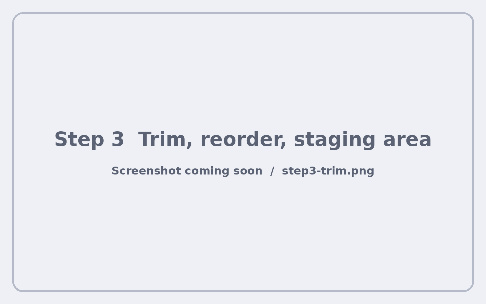
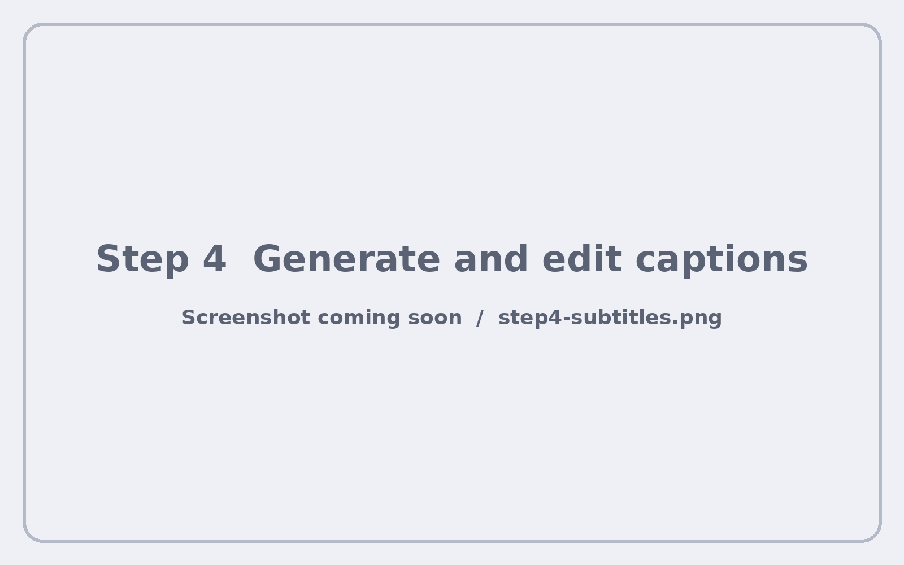
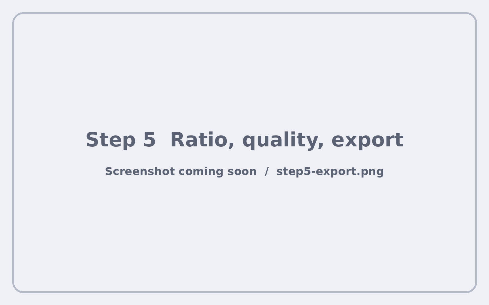
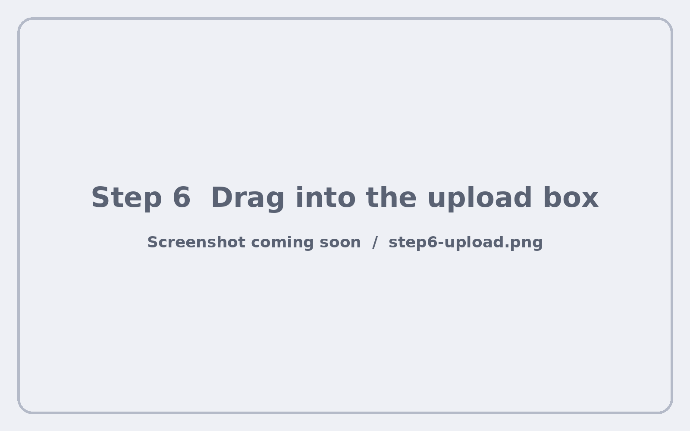

<p align="center">
  
</p>

<h1 align="center">Soon-Cut</h1>

<p align="center">
  <b>English</b> ｜ <a href="README.zh-TW.md">繁體中文</a>
</p>

<p align="center">
  Watch, clip, caption, share — a floating Mac tool that turns what's on your screen into a subtitled short video in minutes.
</p>

<p align="center">
  
</p>

## Contents

- [Features](#features)
- [Installation](#installation)
- [How to use](#how-to-use)
- [FAQ](#faq)
- [Responsible use](#responsible-use)
- [License](#license)

## Features

- **Floating panel** that stays on top without stealing focus from your browser or video player
- **Region capture** with system audio; one click to lock 9:16
- **Clip editing**: trim with a filmstrip, drag to reorder, park clips in a staging area
- **On-device captions** in Traditional Chinese with [WhisperKit](https://github.com/argmaxinc/argmax-oss-swift); edit line by line
- **Multi-ratio export**: original, 9:16, 4:5, 1:1, 16:9 with blurred background, platform hints and length warnings
- **Three quality levels**: 1080p, 720p, 540p with estimated file size
- **Drag to upload**: drop the finished video straight into a web upload box
- **Private by design**: everything runs on your Mac; no account, no cloud, no data collected

---

## Installation

### Option A: Mac App Store

Coming soon. The App Store version is free to download with a small watermark; a one-time purchase removes it.

### Option B: Build from source (free, no watermark)

**Requirements**

- macOS 15 or later, Apple Silicon
- Xcode 16 or later
- [XcodeGen](https://github.com/yonaskolb/XcodeGen)
- About 1.6 GB of free space for the speech model

**1. Get the code and generate the Xcode project**

```bash
brew install xcodegen
git clone https://github.com/pwww/Soon-Cut.git
cd Soon-Cut
xcodegen
open SoonCut.xcodeproj
```

**2. Set your own signing team**

Open `project.yml`, change `DEVELOPMENT_TEAM` to your Apple team ID, then run `xcodegen` again. A stable signature means macOS remembers the screen recording permission between builds.

**3. Build and run**

In Xcode, choose **My Mac** as the destination and press **⌘R**.

**4. Allow screen recording**

The first time you record, macOS asks for permission. Open **System Settings › Privacy & Security › Screen & System Audio Recording**, turn on **SoonCut**, then quit and reopen the app.

<p align="center">
  
</p>

**5. Done**

A short tutorial appears on first launch. You can open it again any time with the **?** button.

---

## How to use

### Step 1 — Frame a region

Open the video or page you want to capture. Click **Range** (範圍) and drag over the area on screen. Turn on **9:16** first if you want a vertical frame. A faint dashed outline keeps showing where the region is.

<p align="center"></p>

### Step 2 — Record

Click **Record** (錄影) or press **⇧⌘R**. The outline turns red while recording. Click again to stop. Record as many clips as you like; each one appears in the clip strip. The speaker button toggles system audio.

<p align="center"></p>

### Step 3 — Trim and arrange

Click a clip to preview it. Drag the yellow handles on the filmstrip to cut the start and end. Drag thumbnails left or right to reorder. Drag a clip down into the **staging area** to leave it out of this video without deleting it.

<p align="center"></p>

### Step 4 — Add captions

Open the **Captions** (字幕) tab and click **Generate captions** (產生字幕). The first time, Soon-Cut downloads a 1.6 GB speech model; after that, captions take seconds. Click a timestamp to jump there, edit any line, or delete it.

<p align="center"></p>

### Step 5 — Choose ratio and quality, then export

Pick a ratio. Soon-Cut shows which platforms it suits and warns you when the video is too long. Pick a quality and check the estimated file size. Click **Export** (輸出影片).

| Ratio | Good for |
| --- | --- |
| Original | Threads |
| 9:16 | Threads, IG Reels, YouTube Shorts, TikTok |
| 4:5 | Threads, IG posts |
| 1:1 | Threads, IG posts, YouTube Shorts |
| 16:9 | Threads, YouTube |

<p align="center"></p>

### Step 6 — Drag to upload

Open the **Output** (輸出) tab. Drag the video card straight into the upload box on Threads or any website, or onto Finder. Mark it **Uploaded** afterwards, and archive old videos to keep the list tidy.

<p align="center"></p>

---

## FAQ

**Where are my files?**
Clips are in `~/Movies/Soon-Cut/Raw`, exported videos in `~/Movies/Soon-Cut/Exports`.

**macOS keeps asking for screen recording permission.**
Make sure `DEVELOPMENT_TEAM` in `project.yml` is set, then run `xcodegen` again. Without a stable signature, every build looks like a new app to macOS.

**How accurate are the captions?**
Traditional Chinese speech is usually above 95% accurate. Background music or several people talking at once lowers accuracy; you can fix any line by hand.

**Which edition am I using?**
The badge at the top right of the panel shows Open source, Free or Pro.

## Responsible use

Soon-Cut is a screen recorder for commentary, tutorials, demos and your own content. Only share recordings of other people's work when you have the right to do so.

## License

Soon-Cut is free software under the [GNU General Public License v3.0 or later](LICENSE).

The **Soon-Cut name and icon are not covered by the license**. If you distribute a modified version, please use a different name and icon.

Contributions are welcome. Please read [CONTRIBUTING.md](CONTRIBUTING.md) first.
