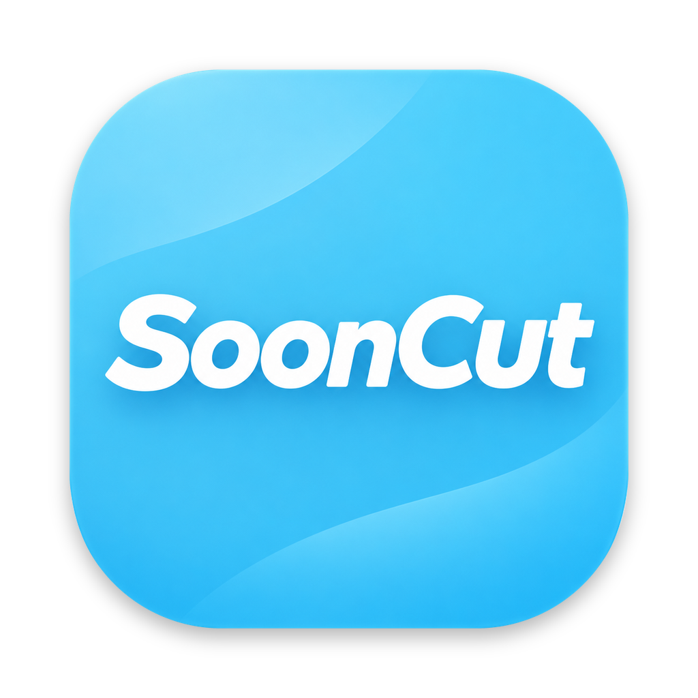

<p align="center">
  
</p>

<h1 align="center">Soon-Cut</h1>

<h3 align="center">螢幕錄影＋自動字幕</h3>

<p align="center">
  <a href="README.md">English</a> ｜ <b>繁體中文</b>
</p>

<p align="center">
  超方便的 Mac 螢幕錄影工具：自動產生字幕、一鍵翻成其他語言，馬上轉成可以分享的短影片，做教學、講解、溝通都好用。
</p>

## 目錄

- [功能](#功能)
- [安裝](#安裝)
- [使用教學](#使用教學)
- [常見問題](#常見問題)
- [使用提醒](#使用提醒)
- [授權](#授權)

## 功能

- **浮動視窗**永遠在最上層，不會搶走瀏覽器或播放器的焦點
- **框選錄影**，含系統聲音；一鍵鎖定 9:16
- **片段剪輯**：拖膠卷條剪頭尾、拖曳排序、暫存區放這次不用的片段
- **本機多語字幕**：用 [WhisperKit](https://github.com/argmaxinc/argmax-oss-swift) 轉寫 10 多種語言；字幕要別的語言時，用 Apple 內建翻譯在本機翻譯；可以逐句修改
- **多比例輸出**：原始、9:16、4:5、1:1、16:9，自動補模糊背景，標示適合的平台與長度上限
- **三種畫質**：1080p、720p、540p，顯示預估檔案大小
- **拖去上傳**：把影片直接拖進網頁上傳框
- **重視隱私**：全部在你的 Mac 上處理，不用帳號、不上雲端、不收集資料

---

## 安裝

### 方式一：Mac App Store

即將推出。App Store 版免費下載，右下角有小浮水印，一次買斷即可移除。

### 方式二：從原始碼編譯（免費、無浮水印）

**需求**

- macOS 15 以上、Apple Silicon
- Xcode 16 以上
- [XcodeGen](https://github.com/yonaskolb/XcodeGen)
- 約 1.6 GB 空間放語音模型

**1. 下載程式碼、產生 Xcode 專案**

```bash
brew install xcodegen
git clone https://github.com/pwww/Soon-Cut.git
cd Soon-Cut
xcodegen
open SoonCut.xcodeproj
```

**2. 設定你自己的簽章團隊**

打開 `project.yml`，把 `DEVELOPMENT_TEAM` 改成你的 Apple 開發者 Team ID，再跑一次 `xcodegen`。簽章固定，macOS 才會記住螢幕錄影權限，不會每次編譯都重問。

**3. 編譯並執行**

在 Xcode 把執行目的地選 **My Mac**，按 **⌘R**。

**4. 允許螢幕錄影**

第一次錄影時 macOS 會要求權限。打開「**系統設定 › 隱私權與安全性 › 螢幕與系統錄音**」，打開 **SoonCut**，然後結束並重新開啟 App。

**5. 完成**

第一次開啟會出現簡短的教學，之後隨時可以按浮動視窗的「**?**」再看一次。

---

## 使用教學

### 步驟 1：框選範圍

打開要錄的影片或網頁，按「**範圍**」，直接在畫面上拖曳框選。想錄直式，先打開「**9:16**」。框好後，範圍外圍會一直有一圈淡淡的虛線提醒你位置。

### 步驟 2：錄影

按「**錄影**」或 **⇧⌘R** 開始，錄影時框線變紅色，再按一次停止。可以連續錄好幾段，每段都會出現在片段列。喇叭按鈕可以開關系統聲音。

### 步驟 3：剪輯與排序

點片段就會在下方播放。拖曳膠卷條兩端的黃色把手剪掉頭尾。左右拖動縮圖可以排順序。把片段往下拖到「**暫存區**」，這次就不會放進輸出，但檔案還在。

### 步驟 4：上字幕

切到「**字幕**」分頁，選「**語音**」（影片說的語言，不確定就選自動偵測）和「**字幕**」語言，按「**產生字幕**」。兩者不同時會用 macOS 內建翻譯在本機翻譯，第一次翻某種語言時系統會請你下載語言包。第一次會下載約 1.6 GB 的語音模型，之後幾秒就能轉好。點時間可以跳到那一句，每句都可以直接修改或刪除。

### 步驟 5：選比例與畫質，輸出

選擇輸出比例，下方會標出適合的平台；影片超過平台長度上限時會提醒你。再選畫質，確認預估檔案大小，按「**輸出影片**」。

| 比例 | 適合 |
| --- | --- |
| 原始 | Threads |
| 9:16 | Threads、IG Reels、YouTube Shorts、TikTok |
| 4:5 | Threads、IG 貼文 |
| 1:1 | Threads、IG 貼文、YouTube Shorts |
| 16:9 | Threads、YouTube |

### 步驟 6：拖去上傳

切到「**輸出**」分頁，把影片卡片直接拖進 Threads 或任何網站的上傳框，也可以拖到 Finder。發完可以標記「**已上傳**」，舊影片可以封存。

---

## 常見問題

**錄好的檔案在哪裡？**
片段在 `~/Movies/Soon-Cut/Raw`，輸出的影片在 `~/Movies/Soon-Cut/Exports`。

**macOS 一直重問螢幕錄影權限。**
確認 `project.yml` 的 `DEVELOPMENT_TEAM` 已經改成你的 Team ID，再跑一次 `xcodegen`。沒有固定簽章時，每次編譯 macOS 都會當成新的 App。

**字幕準不準？**
繁體中文一般有 95% 以上的正確率。有背景音樂或多人同時說話時會下降，每一句都可以手動修改。

**我用的是哪個版本？**
浮動視窗右上方的標籤會顯示「開源版」、「免費版」或「付費版」。

## 使用提醒

Soon-Cut 是用來評論、教學、示範與剪輯自己內容的螢幕錄影工具。轉發他人的作品前，請先確認你有權利這麼做。

## 授權

Soon-Cut 是自由軟體，採用 [GNU 通用公共授權條款第 3 版或更新版本](LICENSE)（GPL-3.0-or-later）。

**「Soon-Cut」名稱與圖示不在授權範圍內。** 如果你發布修改後的版本，請使用不同的名稱與圖示。

歡迎貢獻，請先閱讀 [CONTRIBUTING.md](CONTRIBUTING.md)。開發測試清單見 [docs/TESTING.md](docs/TESTING.md)。
